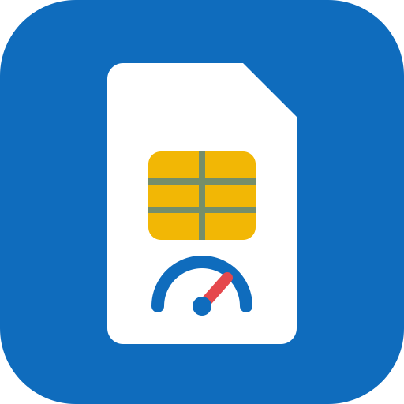
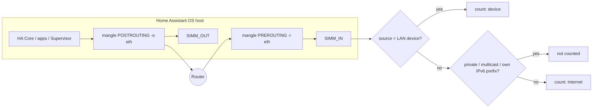

<p align="center">
  
</p>

<h1 align="center">SIM Meter</h1>

<p align="center">
  <b>How many GB a month does your Home Assistant really need?</b><br>
  A Home Assistant app that measures the host's <i>Internet-only</i> traffic and projects it to 30 days,
  so you can size a mobile data SIM before moving Home Assistant onto a 4G/5G router.
</p>

<p align="center">
  <a href="https://my.home-assistant.io/redirect/supervisor_add_addon_repository/?repository_url=https%3A%2F%2Fgithub.com%2Fprocolo75%2Fsim-meter">
    
  </a>
</p>

---

## Why

Your router's counters can't answer the question. They add up Internet traffic *and* local traffic:
dashboards on tablets, voice satellites, ESPHome nodes, media servers. On a SIM only the part that
leaves the house counts, and that part can hold surprises.

The first run of SIM Meter found one. An integration downloaded two files every minute
(7.4 MB + 1.3 MB): **about 375 GB a month**, invisible among the LAN traffic. The built-in traffic diagnostic named
the remote host in two minutes.

## Features

- **Internet-only counting** on the host's physical interface. Private, link-local and multicast
  ranges are excluded, as are your LAN's own public IPv6 prefixes, detected automatically.
- **Covers everything on the host**: Home Assistant Core, Supervisor, every app, updates,
  Nabu Casa / remote access, cloud TTS/STT.
- **Optional LAN device counter**: a device that will stay on your main network (for example a
  wall-panel tablet) will reach Home Assistant through the Internet once HA sits behind a SIM.
  Its traffic is counted separately.
- **30-day projection**, with variants without the LAN device and with a 25 % safety margin.
- **Traffic diagnostic** button: captures traffic for 30 s to 1 h and tells you **who** is using it:
  a per-app summary with its 30-day projection, then the top 25 remote hosts with MB down/up,
  port, reverse DNS and the app behind each one.
- **Survives restarts and reboots**: totals are persisted and counter resets are detected.
- **Read-only on your network**: the firewall rules only count bytes and are removed when the app stops.
- **MQTT Discovery**: sensors appear on their own and are recorded in long-term statistics.
- IPv4 and IPv6, `amd64` / `aarch64` / `armv7`.

## Installation

1. Click the button above, or go to **Settings → Apps → Install App → ⋮ → Repositories** and add
   `https://github.com/procolo75/sim-meter`.
2. Install **SIM Meter** and start it.
3. Make sure you have an MQTT broker. With the official **Mosquitto broker** app the credentials
   are picked up automatically.

## Configuration

| Option | Default | Description |
|---|---|---|
| `tablet_ip` | *(empty)* | IPv4 of one LAN device whose traffic with HA should be counted (see above). |
| `poll_interval` | `60` | Seconds between counter reads / sensor updates. |
| `diagnostic_seconds` | `120` | Duration of the traffic diagnostic capture (30–3600). |
| `mqtt_host` | *(empty)* | Empty = broker from the Mosquitto app. |
| `mqtt_port` | `1883` | |
| `mqtt_user` / `mqtt_password` | *(empty)* | Empty = credentials from the Mosquitto app. |

## Entities

All entities belong to the **SIM Meter** device. Data sizes are in decimal GB, the way carriers count.

| Entity | Type | Description |
|---|---|---|
| `sensor.sim_internet_download` | total increasing | GB received from the Internet |
| `sensor.sim_internet_upload` | total increasing | GB sent to the Internet |
| `sensor.sim_tablet_traffic` | total increasing | GB exchanged with the `tablet_ip` device |
| `sensor.sim_totale` | total increasing | Internet + LAN device: what the SIM would carry |
| `sensor.sim_stima_30_giorni` | measurement | 30-day projection. Attributes: `giorni_misurati`, `inizio_misura`, `stima_senza_tablet_gb`, `stima_con_margine_25_gb` |
| `button.sim_azzera_misura` | button | Reset totals and start measuring again |
| `button.sim_diagnostica_traffico` | button | Run the traffic diagnostic (results in the app log) |

### Diagnostic output (app log, example)

```text
DIAGNOSTICA: 83.2 MB in 3600s (= 59.9 GB/30gg a questo ritmo)
Per origine:
     40.10 MB  giu   38.20  su    1.90    28.9 GB/30gg  Blink MQTT
     31.40 MB  giu    5.80  su   25.60    22.6 GB/30gg  HA Core / rete host (SIM Meter)
      6.20 MB  giu    0.90  su    5.30     4.5 GB/30gg  JARVIS
Principali indirizzi:
     11.57 MB  giu   10.44  su    1.12  18.238.158.21 porta 443  (server-18-238-158-21.fco50.r.cloudfront.net)  ← Blink MQTT
     ...
```

Entity names are in Italian, the author's language; the entity IDs above stay the same whatever
your Home Assistant language is.

> **Tip:** `sensor.sim_totale` works with a `utility_meter` helper. Once you're on the SIM, a monthly
> meter on it shows how much of the plan you've used.

## How it works



- The app runs with `host_network` and `NET_ADMIN`. It adds two counting chains to the host's
  `mangle` table, hooked on the interface that holds the default route. It picks the iptables backend
  (nft or legacy) the host itself uses.
- Every rule ends in `RETURN`: packets are counted, never dropped or changed.
- Every `poll_interval` seconds the byte counters are read and the deltas added to the totals in
  `/data/state.json`. A counter going backwards (host reboot, rules recreated) is handled as a reset.
- The diagnostic runs `tcpdump` on the same interface and, at the same time, on the Docker bridges
  (`hassio`, `docker0`), where each app's traffic is still seen with its own container IP, before NAT.
  Matching the two captures by remote host and port, and the container IPs against the Supervisor API,
  gives each flow an owner. Traffic never seen on a bridge belongs to the host itself: Home Assistant
  Core with its integrations, plus the apps that use the host network, which can't be told apart.

## Reading the numbers

- **Wait at least a day.** In the first hours the projection multiplies every burst (an update, a
  backup) by up to ~720.
- **Remote access changes**: when your phone uses the HA app at home today, that's LAN traffic. If
  the app goes through Nabu Casa it is already counted.
- **Devices that move with HA** onto the SIM router's Wi-Fi (sensors, Zigbee/ESPHome, voice
  satellites) talk to it locally and cost nothing. Only devices left on the *other* network matter;
  that's what `tablet_ip` is for.
- Add a margin for monthly app/OS updates (a few hundred MB). The `stima_con_margine_25_gb`
  attribute does that for you.

## Limitations

- It measures the **Home Assistant host only**, not other devices on your network.
- One extra LAN device can be tracked (`tablet_ip`, IPv4).
- The diagnostic needs about as long as the behaviour you want to catch: set `diagnostic_seconds`
  accordingly, and note the time of the tests you run while it captures.

## Development

```bash
pip install pytest
pytest -q tests
```

The tests cover the parsing of iptables output, the IPv6 prefix detection, the capture aggregation,
counter-reset handling and the 30-day projection.

See [CHANGELOG](sim-meter/CHANGELOG.md) for the release history.
